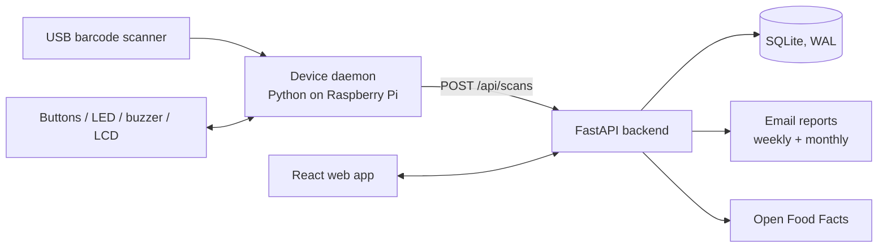

# fridged

A barcode scanner mounted next to the fridge, plus a small website, that shows what the household really spends on groceries, what is actually used, and what needs to be bought next.

Scan groceries **in** when you get home. Scan an item **out** when you start using it. The system keeps the inventory, adds items that run out to a shopping list, and emails a weekly and monthly report.

> Status: early development. Hardware is on order; the website is being designed first.

## Why

Receipts tell you what you bought, not what you consumed. This project tracks both and shows the gap:

- **Spent**: price of everything scanned in.
- **Used**: price of everything scanned out (opened/started).
- **Gap**: spent minus used, i.e. what is sitting in the fridge or went to waste.

It is also a hands-on portfolio project: Python on real hardware, a FastAPI backend, a React frontend, deployment on a Raspberry Pi, and (later) AI features.

## How it works

The scanner has three modes, switched with printed command barcode cards:

| Mode | Purpose | Card |
| --- | --- | --- |
| **OUT** (default) | Scan an item when you start using it. Decreases stock, adds its price to *Used*. | `FT:MODE:OUT` |
| **IN** | Scan groceries after shopping. Increases stock, adds price to *Spent*. Returns to OUT after 120 s. | `FT:MODE:IN` |
| **STOCKTAKE** | First fill of the fridge. Records stock without counting it as spending. Returns to OUT after 10 min. | `FT:MODE:STOCKTAKE` |

Undo the last scan with `FT:UNDO`. The cards are Code 128 barcodes; `tools/make_cards.py` prints them.

Feedback on the device: RGB LED, buzzer and a 16x2 LCD show what happened (stocked, used, new item, needs a price, not in stock, duplicate).

### Pricing

There is no public Swedish grocery price API, so each product gets a price **once**, entered in the web app (`12,50` and `12.50` are both accepted). Product names come from Open Food Facts. Unpriced items show up under *Needs price* and are left out of totals until priced.

## Architecture



- The **daemon never touches the database**. All business rules live in the backend, so the website, the device and the reports always agree.
- Scans are posted with a client-generated UUID, so retries are safe. If the backend is unreachable, the daemon queues scans offline and replays them later.
- The scanner code is a small, separate module (`device/src/fridged/scanner/`) behind a narrow interface so it can be rewritten in C++ later.
- Home network only in v1, no login.

## Tech stack

| Part | Stack |
| --- | --- |
| Device daemon | Python 3.11+, evdev (USB HID scanner), gpiod, pytest |
| Backend | FastAPI, SQLAlchemy 2.0, Alembic, Pydantic v2, SQLite (WAL) |
| Frontend | React, TypeScript, Vite, TanStack Query, Recharts, Tailwind, React Router, openapi-typescript |
| Deployment | systemd services and timers on the Pi, backend serves the built frontend |
| Reports | SMTP email |

## Hardware

Bill of materials for the v1 build:

- Raspberry Pi 3 Model B (used), 16 GB microSD, case
- Official 12.5 W micro-USB power supply (5.1 V / 2.5 A)
- USB barcode scanner (HID keyboard mode)
- Parts from an Elegoo Uno starter kit: RGB LED, buzzer, two buttons, LCD1602, breadboard, resistors

GPIO is 3.3 V only. Pin map (BCM numbering):

| Function | GPIO |
| --- | --- |
| LED red / green / blue | 17 / 27 / 22 |
| Buzzer | 18 |
| MODE button | 5 |
| UNDO button | 6 |
| LCD RS / E | 25 / 24 |
| LCD D4-D7 | 23 / 12 / 16 / 20 |

Use `libgpiod` rather than pigpio (pigpio does not support the Pi 5). Check the libgpiod major version first, since the v1 and v2 APIs differ, and confirm the chip with `gpiodetect`. The code is intended to stay portable to a Pi 4/5 later.

## Data model

All amounts are integer **öre**. Timestamps are stored in UTC; periods are computed in Stockholm time.

| Table | Notes |
| --- | --- |
| `products` | Barcode, name, pack size, last price, restock policy |
| `events` | Append-only log of `in`, `out`, `stocktake`, `adjust`; can be reverted, never deleted |
| `stock_batches` | One batch per stock-in, so the oldest batch is used first |
| `price_history` | Every price a product has had |
| `shopping_items` | Auto or manual, `open` / `bought` / `dismissed` |
| `report_runs` | Which reports were sent |

Spent = price of non-reverted `in` events. Used = price of non-reverted `out` events. Gap = Spent - Used.

## Website

Mobile-first, tap targets of at least 44 px, money formatted as `12,50 kr`, confirmation before reverts and adjustments.

| Page | Route | What it shows |
| --- | --- | --- |
| Dashboard | `/` | Spent, used, gap for this week and month with change vs last period, 12-week chart, top 5 items, unpriced and shopping counts |
| Inventory | `/inventory` | Units, oldest batch date, value, search |
| Needs price | `/needs-price` | Inline price entry for unpriced products |
| Shopping list | `/shopping` | Tick off bought, dismiss, add free text, auto/manual badge |
| History | `/history` | Every event, with undo |
| Product | `/products/:id` | One product: stock, price history, events |

## Repository layout

```
fridged/
├── README.md
├── docs/              # spec, wiring notes, short decision records (adr/)
├── device/            # Python daemon "fridged"
├── backend/           # FastAPI app
├── frontend/          # Vite + React + TypeScript
├── tools/             # make_cards.py prints the command barcode cards
└── deploy/            # systemd units, install/update/backup scripts
```

The full project spec is the source of truth; export it to `docs/spec.md`.

## Getting started

Nothing is runnable yet. Planned dev setup:

```bash
# backend
cd backend
python -m venv .venv && source .venv/bin/activate
pip install -e ".[dev]"
alembic upgrade head
uvicorn app.main:app --reload

# frontend
cd frontend
npm install
npm run dev
```

The frontend is built on a normal PC, not on the Pi (1 GB RAM). The backend serves the built files in production.

## Roadmap

- [ ] Repo, tooling, CI skeleton
- [ ] Backend: schema, migrations, `POST /api/scans`, business rules with tests
- [ ] Frontend: Dashboard, Inventory, Needs price, Shopping list, History, Product
- [ ] Pi setup: Raspberry Pi OS Lite 64-bit, hostname `fridge`, SSH key, Wi-Fi, Europe/Stockholm
- [ ] Device daemon: scanner input, mode controller, backend client, offline queue
- [ ] Feedback hardware: LED, buzzer, buttons, LCD
- [ ] Email reports (weekly and monthly) and nightly backups
- [ ] Open Food Facts lookup for product names
- [ ] Later: receipt-photo pricing, recipe suggestions, expiry dates, scanner module in C++

## License

To be decided.
