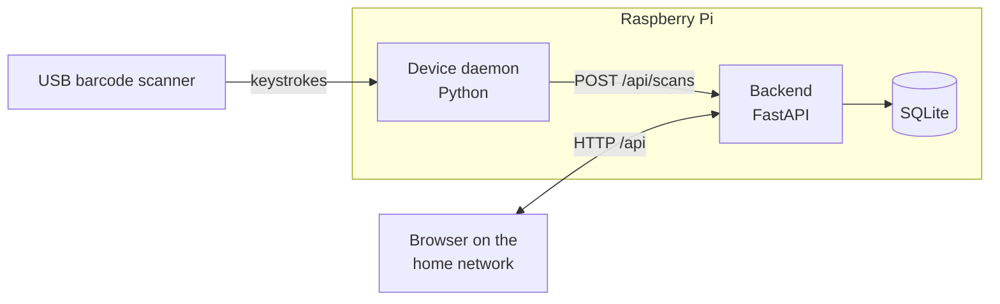

# fridged

A barcode scanner mounted next to the fridge, plus a small website, that shows what the household really spends on groceries, what is actually used, and what needs to be bought next.

Scan groceries **in** when you get home. Scan an item **out** when you start using it. The system keeps the inventory, adds items that run out to a shopping list, and emails a weekly and monthly report.

> Status: early development.

## Why

Receipts tell you what you bought, not what you consumed. This project tracks both and shows the gap:

- **Spent**: price of everything scanned in.
- **Used**: price of everything scanned out (opened/started).
- **Gap**: spent minus used, i.e. what is sitting in the fridge or went to waste.

## How it works

### Scan modes

The scanner has three modes, switched by scanning printed command cards (Code 128 barcodes).

| Mode              | Card                | What a scan does                                                                                         |
| ----------------- | ------------------- | -------------------------------------------------------------------------------------------------------- |
| **OUT** (default) | `FT:MODE:OUT`       | Uses one package: stock goes down, its price counts as _Used_.                                           |
| **IN**            | `FT:MODE:IN`        | Adds one package after shopping: stock goes up, its price counts as _Spent_. Returns to OUT after 120 s. |
| **STOCKTAKE**     | `FT:MODE:STOCKTAKE` | Records existing stock on the first fill without counting it as spending. Returns to OUT after 10 min.   |

`FT:UNDO` reverts the last scan.

### Registers

A barcode identifies a product, not a single package: two scans of the same milk carton barcode mean a stock of two.

- An unknown barcode creates a product in the **unknown register**, holding only the barcode.
- On the website you fill in its name, brand and price once. It moves to the **known register**, and its earlier IN and OUT scans get that price.
- After that, every scan of the barcode is recognised immediately.

Products in the unknown register count towards stock but stay out of Spent and Used until they have a price.

### Ledger

Every scan is stored as an event. All numbers are computed from the events that have not been reverted:

| Number              | Formula                                         |
| ------------------- | ----------------------------------------------- |
| Stock (per product) | count(`in`) + count(`stocktake`) - count(`out`) |
| Spent               | sum of `unit_price_ore` over `in` events        |
| Used                | sum of `unit_price_ore` over `out` events       |
| Gap                 | Spent - Used                                    |

`stocktake` events add to stock but never count towards Spent or Used.

## Architecture



## Hardware

Materials for the v1 build:

- Raspberry Pi 3 Model B (used), 16 GB microSD, case
- Official 12.5 W micro-USB power supply (5.1 V / 2.5 A)
- USB barcode scanner (HID keyboard mode)
- Parts from an Elegoo Uno starter kit: RGB LED, buzzer, two buttons, LCD1602, breadboard, resistors

GPIO is 3.3 V only. Pin map (BCM numbering):

| Function               | GPIO              |
| ---------------------- | ----------------- |
| LED red / green / blue | 17 / 27 / 22      |
| Buzzer                 | 18                |
| MODE button            | 5                 |
| UNDO button            | 6                 |
| LCD RS / E             | 25 / 24           |
| LCD D4-D7              | 23 / 12 / 16 / 20 |

Use `libgpiod` rather than pigpio (pigpio does not support the Pi 5). Check the libgpiod major version first, since the v1 and v2 APIs differ, and confirm the chip with `gpiodetect`. The code is intended to stay portable to a Pi 4/5 later.

The full project spec is the source of truth; export it to `docs/spec.md`.

## Getting started

Nothing is runnable yet. Planned dev setup:

```bash
# backend
cd backend
python -m venv .venv && source .venv/bin/activate
pip install -e ".[dev]"
alembic upgrade head
uvicorn app.main:app --reload

# frontend
cd frontend
npm install
npm run dev
```

The frontend is built on a normal PC, not on the Pi (1 GB RAM). The backend serves the built files in production.

## License

To be decided.
