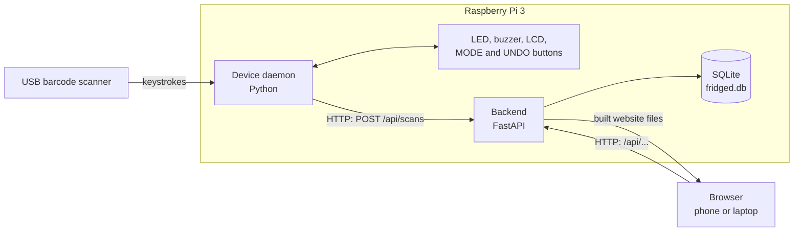
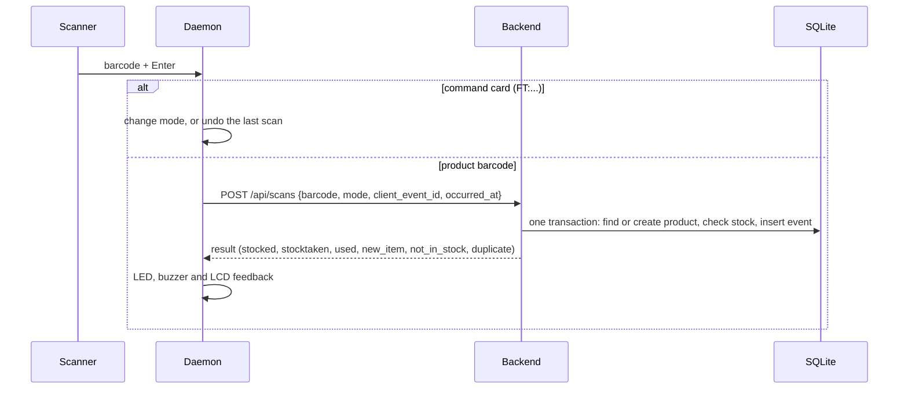
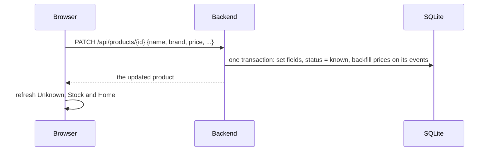
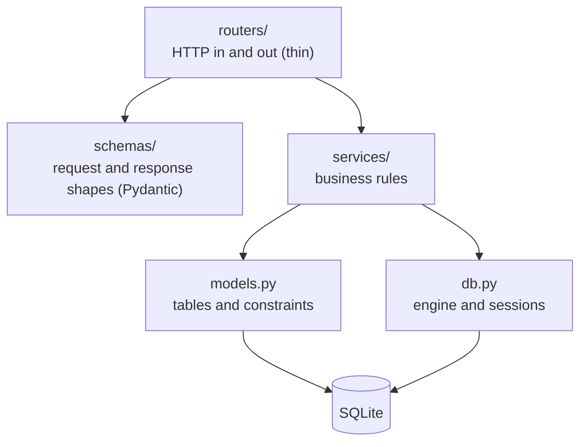

# fridged: architecture

A USB barcode scanner sits next to the fridge, connected to a Raspberry Pi. Items are scanned IN after shopping and OUT when they are started. A small program on the Pi (the device daemon) sends every scan to a backend, which applies all the rules and stores the scans as events in a SQLite database. A website, opened on a phone or laptop on the home network, reads the same data and shows stock, spending and the items waiting to be identified.

This document is the overview. Details live elsewhere:

| Topic                                                | Document                                           |
| ---------------------------------------------------- | -------------------------------------------------- |
| Tables, scan rules, how stock and money are computed | [data-model.md](data-model.md)                     |
| Website pages and the API they use                   | [pages.md](pages.md)                               |
| Why specific decisions were made                     | [adr/](adr/)                                       |
| Pins and wiring on the Pi                            | [wiring.md](wiring.md) (TBD)                       |
| How to run the backend, file layout                  | [../backend/README.md](../backend/README.md) (TBD) |

---

## Components

| Component       | Folder               | Runs on                       | Built with                                        | Job                                                                                                                                          |
| --------------- | -------------------- | ----------------------------- | ------------------------------------------------- | -------------------------------------------------------------------------------------------------------------------------------------------- |
| Barcode scanner |                      | USB on the Pi                 | Acts as a keyboard                                | Types the barcode digits and presses Enter                                                                                                   |
| Device daemon   | `device/`            | Raspberry Pi                  | Python, evdev, gpiod                              | Reads scans, handles command cards and modes, sends scans to the backend, queues them while offline, drives the LED, buzzer, LCD and buttons |
| Backend         | `backend/`           | Raspberry Pi                  | FastAPI, SQLAlchemy, Alembic                      | All business rules, the HTTP API, and (in production) serving the built website                                                              |
| Database        | `backend/fridged.db` | Raspberry Pi                  | SQLite in WAL mode                                | Stores `products` and `events`                                                                                                               |
| Website         | `frontend/`          | A browser on the home network | React, TypeScript, Vite, TanStack Query, Tailwind | Shows stock, spending, the unknown register and history, and edits products                                                                  |



---

## Flow: a scan



1. The scanner types the digits and presses Enter. The daemon reads them directly with evdev, so they never reach a terminal.
2. **Command cards** (`FT:MODE:OUT`, `FT:MODE:IN`, `FT:MODE:STOCKTAKE`, `FT:UNDO`) are handled by the daemon. Mode changes stay local. IN returns to OUT after 120 s, STOCKTAKE after 10 min. Undo asks the backend to revert the daemon's last event.
3. **Every other barcode** is sent to the backend with the current mode, a fresh UUID and the time of the scan.
4. The backend normalizes the barcode, then in **one transaction** finds or creates the product, checks stock and records the event (or records nothing, for example for an OUT scan with no stock). The rules are in the scan-rules table in [data-model.md](data-model.md).
5. The daemon shows the result on the hardware: for example green for `stocked`, an error tone for `not_in_stock`.

### Offline and retries

- If the backend can't be reached, the daemon stores the scan in a local queue and sends it later, in order.
- `occurred_at` is when the item was scanned and `received_at` is when the backend got it, so a late scan still lands in the right week.
- If a retry sends a scan the backend already has, the unique `client_event_id` makes the backend answer `duplicate` and record nothing.

---

## Flow: the website

**Loading a page** (for example Home):

1. The browser calls `GET /api/summary?period=week` through TanStack Query.
2. The backend computes spent, used and gap from the events and returns integers in öre.
3. The page formats them as `12,50 kr`. Nothing is calculated in the browser.

**Handling an unknown item:**



After saving, TanStack Query marks the affected data as outdated, so the Unknown badge, the Stock list and the Home totals refresh automatically.

---

## Inside the backend

The backend is split into layers, each with one job. Step 1 created the bottom layers. The others are added from step 2.



| Layer                         | Job                                                            |
| ----------------------------- | -------------------------------------------------------------- |
| `main.py`                     | Creates the app and includes the routers                       |
| `config.py`                   | Settings from `FRIDGED_*` environment variables                |
| `db.py`                       | Engine, SQLite settings, one session per request               |
| `models.py`                   | The `products` and `events` tables and their rules             |
| `routers/`                    | Receives the HTTP request, calls a service, returns the result |
| `schemas/`                    | Describes and validates the JSON the API takes and returns     |
| `services/`                   | All rules: scans, stock, handling unknown items, totals        |
| `barcodes.py`, `timeutils.py` | Pure helper functions (normalization, Stockholm periods)       |

Two rules for the layers:

- **Routes stay thin.** If a route contains an `if` about stock or prices, the logic belongs in a service.
- **Services do not know about HTTP.** They take a session and plain values, so they can be tested without a test client.

Schema changes are made with Alembic migrations (`backend/alembic/versions/`), never by editing the database by hand.

---

## Deployment

**Production (the Pi):**

- Raspberry Pi 3 Model B with Raspberry Pi OS Lite 64-bit, hostname `fridge`, Europe/Stockholm time zone.
- Two systemd services: the backend (uvicorn) and the daemon. Both start at boot and restart if they crash.
- The website is built on the Mac (`npm run build`) and the backend serves the built files, so the Pi does not need Node.
- Home network only.
- The database is one file. Backups are copied with `sqlite3 .backup`, not `cp`, because of WAL.

**Development (the Mac):**

- Backend: `uvicorn app.main:app --reload` on port 8000.
- Website: `npm run dev` (Vite). Vite forwards `/api` to `localhost:8000`, so the browser talks to one address.
- Before the hardware arrives, scans are simulated with `curl` or a fake-scan script against `POST /api/scans`.

---

## Repository layout

```
fridged/
  docs/        architecture, data model, pages, ADRs, wiring
  backend/     FastAPI app, models, migrations, tests
  frontend/    React website
  device/      the daemon that runs on the Pi
  tools/       helper scripts (command cards, fake scans)
  deploy/      systemd units and install, update and backup scripts
```

---

## Ideas for later

These are planned without changing the architecture above. Each one is a new table or column added by migration, plus new services and pages:

- Expiry dates and days in the fridge (`stock_items`)
- Shopping list and `min_stock`
- Price history
- Weekly and monthly email reports (systemd timer)
